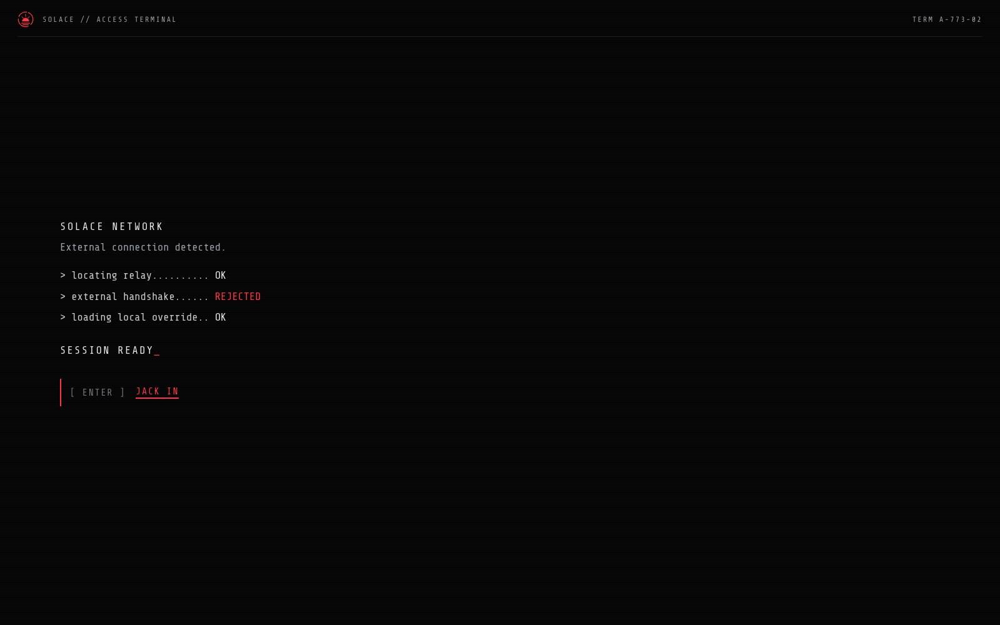
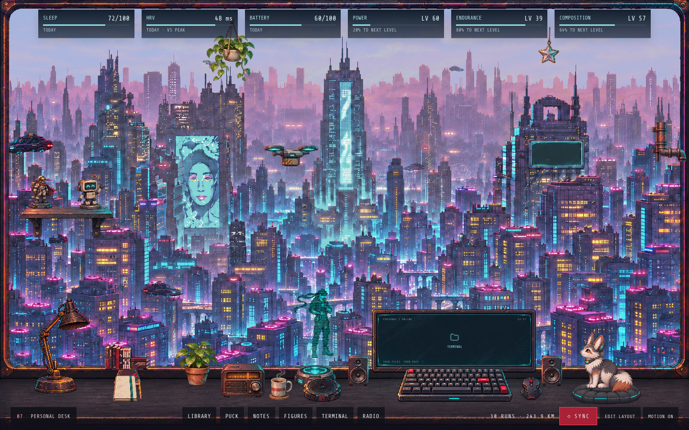
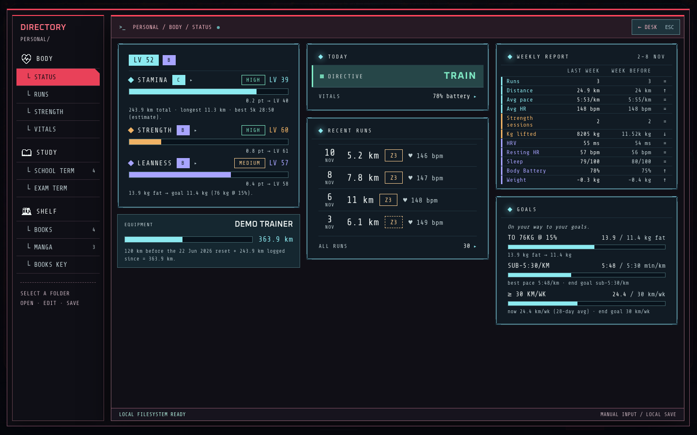
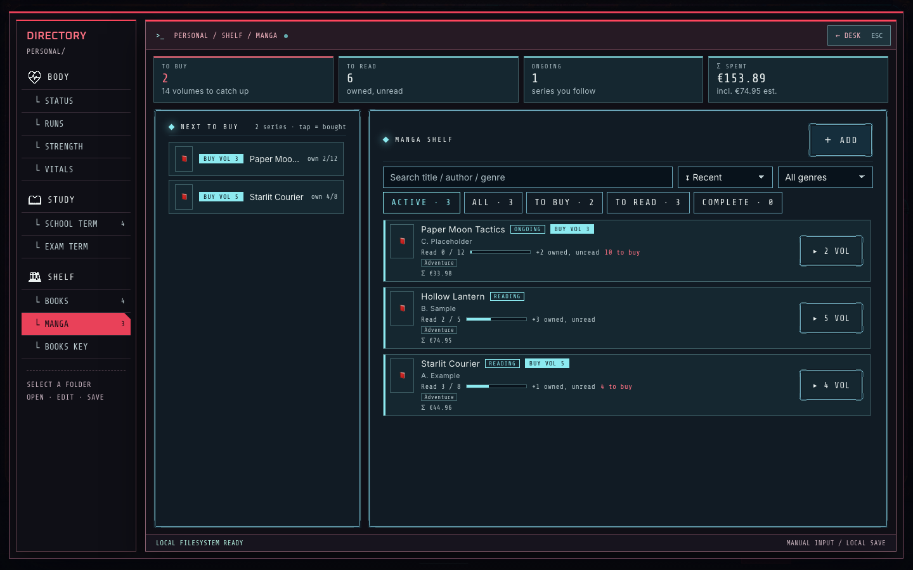

# Solace

Solace is a local-first personal OS that runs in your browser: a customisable desk where you keep your books and manga,
school and exams, work or any other tasks, and track your training through Garmin. Everything runs on your machine from
one SQLite file: no account, no cloud.

> Personal project, shared as-is. It is deliberately broad, and single-user and local-first by design. The stat engine is
> deterministic: the same data always gives the same stats.

It is made for one person's own use. If you want to run your own local copy, the setup is below.

**Inspired by** the YoRHa interface of NieR:Automata and the look of Cyberpunk 2077. Solace is an independent fan
project: no affiliation with or endorsement by Square Enix, PlatinumGames, CD PROJEKT RED or anyone else. All
trademarks belong to their owners, and none of those names is used as the name of this product.

## What it looks like







You start on a "jack in" start screen. After you enter you land on your desk: a desk above a city, with tools you can
open (terminal, library, hologram showcase, radio, scratchpad, small companions). You customise the desk yourself, and your key
stats stay visible in a footer bar; the run and km totals sit in the bar at the bottom. Click the hologram on the desk to zoom
in on a body showcase: your stat levels light up the hologram, your condition today, your journey since the fresh start and
the **⟲ SYNC GARMIN** button with what the last sync brought.
Everything else lives in the terminal on the monitor: click the monitor (or TERMINAL in the bottom bar) and it zooms in
to nearly fill the screen; Esc or a click outside zooms back out. The terminal has three folders (the whole app is one
dark style, there is no theme switch). The links `#body`, `#study` and `#shelf` (also `#body/vitals`, `#shelf/manga` and so
on) open the desk with the terminal zoomed on that folder, `#desk` is the desk, and the old `#home`, `#training`, `#school`
and `#archives` links still work:

- **BODY** (training)
  - **STATUS**: your three stats, readiness (`go_hard` / `go_easy` / `rest`) and a weekly report (last week vs the week before).
  - **RUNS**: imported runs with heart-rate zones, pace, weather and shoe mileage.
  - **STRENGTH**: log gym sessions in a form (reps x kg, or seconds for holds like a plank); per-lift points for bench,
    squat and sumo deadlift.
  - **VITALS**: HRV, sleep, resting heart rate, Body Battery and weight, plus your goals (goal weight, body fat %, pace, weekly km).
- **STUDY**: exams (Belgian /20 scale, resits, deliberation) and school tasks.
- **SHELF**: books and manga as Series, Volume, Copy and Purchase, with per-volume ownership and read status,
  box-set purchases and price estimates from a price table.

On top of the training data sits a game-like stat layer: STAMINA, STRENGTH and LEANNESS (0 to 100), a daily readiness
call and goal quests. Formulas are in [`docs/FORMULAS.md`](docs/FORMULAS.md).

Plans and progress are in [`ROADMAP.md`](ROADMAP.md).

## Try the demo

The demo fills a separate database with invented runs, wellness, strength sessions, exams, school tasks, books and
manga, dated relative to today. It never touches your real `data/solace.sqlite` and runs next to it on its own ports.

```sh
npm install
npm run demo   # re-seeds data/demo.sqlite, then API on :8797 and web UI on :5177; Ctrl+C stops both
```

Open <http://localhost:5177>. Garmin sync is disabled in the demo. To only (re)create the demo data:
`npm run cli seed -- --demo` (refuses if `data/demo.sqlite` exists; add `--reset` to replace it).

## Run with Docker

One container runs the API and the web UI (the same two processes as `npm start`), on demo data by default.

```sh
docker compose up --build   # then open http://localhost:5174
docker compose down         # stops it; your data stays in the volume (add -v to delete it)
```

- **Data** lives in the named volume `solace-data`, mounted at `/app/data` (the `.sqlite`, `-wal` and `-shm` files together). The demo database is seeded once on first start; your edits persist.
- **Demo or your own data:** `SOLACE_DEMO=0 docker compose up` uses `data/solace.sqlite` in the same volume (created on first start). The default, `SOLACE_DEMO=1`, uses fake data and disables Garmin sync.
- **Port:** only the web UI is published, on `127.0.0.1` (never your network); the API stays inside the container and the UI proxies `/api` to it. Change the host port with `SOLACE_PORT=5180`.
- **Garmin sync (optional, `SOLACE_DEMO=0` only):** log in once on your own machine (see Garmin sync), then uncomment the `~/.garminconnect` volume in `compose.yaml`. It must be read-write because the token is refreshed. Without a token, SYNC GARMIN shows a clear error.
- **Price table:** the container uses `config/price-table.example.json`; uncomment the `price-table.json` volume in `compose.yaml` to use your own.

## Requirements and setup

- **Node 22** (see `.nvmrc`), for example `nvm install 22` or Homebrew `brew install node@22`. Other major versions
  break the compiled `better-sqlite3` module.
- Optional: [`uv`](https://docs.astral.sh/uv/) for the Garmin sync, `sqlite3` for the tweaks below.

```sh
git clone <this repo> && cd solace
npm install
npm run cli seed   # creates data/solace.sqlite with example athlete values and one example shoe
npm start          # API server on :8787 and web UI on :5174
```

Open <http://localhost:5174>. The desk and avatar artwork (`frontend/src/assets/private/`) is included, so a fresh clone shows the full desk. `npm start` runs `start.sh`, which looks for Node 22 (Homebrew keg or nvm) and starts both
processes; Ctrl+C stops both. You can also run them separately: `npm run server` and `npm run web`.

Newer npm versions block dependency install scripts. If `better-sqlite3` reports a missing bindings file, run
`npm install-scripts approve better-sqlite3 esbuild fsevents && npm rebuild`.

`@garmin/fitsdk` is installed from npm under Garmin's FIT Protocol License, not MIT; it is not part of this repository's code.

**Where your data lives:** `data/solace.sqlite` (git-ignored, created on first run). It is in WAL mode, so a backup
needs all three files: stop the server, then copy `solace.sqlite`, `solace.sqlite-wal` and `solace.sqlite-shm`.
Copying only the first file gives a stale backup.

> Every `npm run cli <cmd>` and every server start applies pending database migrations. To experiment without touching
> your real data, point at a scratch file first: `export SOLACE_DB=$(mktemp -d)/t.sqlite`.

## Mac app

Solace can run as a Mac app (Electron) instead of `npm start`. You build it yourself on your own Mac (unsigned, no download). It starts the same API server and web UI from this repo folder and uses the same database and `.env`. Details, shortcuts and build steps: [`docs/mac-app.md`](docs/mac-app.md). After `npm run desktop:build`, quit Solace (⌘Q) and replace `/Applications/Solace.app` with the new build from `desktop/dist/`; a second Solace only focuses the one already running, so an old copy keeps showing the old version.

## Desk radio

Click the radio on the desk for a close-up with LOFI, JAZZ and BOSSA stations, play/pause, next and a volume knob. Without
Spotify it plays the 6 local Open Lo-Fi tracks. Inside the Mac app it can play your own Spotify playlists instead
(Spotify Premium; Solace controls your Spotify app, the sound plays there). One-time setup:

1. Create an app at <https://developer.spotify.com/dashboard> (Web API). Add these redirect URIs (Spotify forbids `localhost`):
   `http://127.0.0.1:5174/spotify-callback` (the Mac app's default web port; use your `SOLACE_WEB_PORT` if you changed it).
2. Put the app's Client ID in `.env` at the repo root: `SOLACE_SPOTIFY_CLIENT_ID=<your client id>` (no secret is needed).
3. Start the Mac app (`npm run desktop`, or your built Solace.app), open the radio and press CONNECT. Log in at Spotify once; the app keeps and refreshes the login.
4. Open the radio's "Spotify setup" and paste a playlist link for each station (Spotify: playlist, Share, Copy link).
5. Keep the Spotify app open on the Mac. If it is not, the radio says "OPEN SPOTIFY TO PLAY" and offers a button to open it, or to play the local lofi instead.

Playlist links and the Client ID stay on your Mac (browser storage and `.env`), never in the repo. The Spotify logo is not
shipped in this repo (Spotify's brand rules); the glass shows the text mark "Spotify" and an OPEN SPOTIFY link until you put
Spotify's official logo (from their design guidelines page) at `frontend/src/assets/private/spotify-logo-v1.png`.

## Garmin sync

The sync pulls new runs (`.fit` files) and wellness data (HRV, sleep, resting heart rate, Body Battery) from Garmin
Connect, stores them, backfills run temperatures from Open-Meteo and recomputes your stats. It is idempotent.

> **Warning:** this uses an unofficial Garmin API. That is against Garmin's terms of service and may get your account
> blocked. Use it at your own risk, only for your own account, and do not poll aggressively.

1. Install [`uv`](https://docs.astral.sh/uv/). If it is not in `/opt/homebrew/bin` or on your `PATH`, set `SOLACE_UV_BIN`.
2. Log in once (interactive, in your own terminal). This stores a token in `~/.garminconnect`:

   ```sh
   uvx --python 3.12 --from git+https://github.com/Taxuspt/garmin_mcp@0.1.0 garmin-mcp-auth --force-reauth
   ```

   Run the same command again when the sync reports that your login expired (the token lasts months).
3. Click the hologram on the desk and sync with **⟲ SYNC GARMIN** in the showcase. While it runs, the hologram on the desk shows a scanning state.

## Your own data

- **Goals:** VITALS tab. Goal weight, body fat %, pace and weekly km drive LEANNESS and the goal quests. Unset goals use neutral defaults.
- **Weight:** the VITALS tab.
- **Price table:** `mkdir -p source-exports && cp config/price-table.example.json source-exports/price-table.json` and edit the prices (integer EUR
  cents). Without your own file the made-up example is used. `SOLACE_PRICE_TABLE` points elsewhere.
- **Strength:** the STRENGTH tab. `weightKg` is the TOTAL weight per set; a different session on a date that already has one is refused.
- **Max HR, resting HR and HRV baseline:** these are not editable in the UI. Stop the server, then:

  ```sh
  sqlite3 data/solace.sqlite "UPDATE athlete_config SET max_hr = 185, resting_hr_baseline = 55, hrv_baseline_ms = 60 WHERE id = 1;"
  ```

  Use a measured max heart rate for accurate zones, not a formula.
- **Start dates:** `STRENGTH_FRESH_START` and `LEANNESS_FRESH_START` in `backend/core/src/gamification/goals.ts` are
  configurable in code: strength sessions before the first are not counted, and LEANNESS measures progress from the
  first weigh-in on or after the second. Edit those constants to start from a different date.

## Security

- The API has **no login**. It binds to `127.0.0.1` by default, so only your own machine can reach it.
- Writes from other websites (cross-site `Origin`) and DNS-rebinding requests (a non-localhost `Host` header) are refused with 403.
- `HOST=0.0.0.0` exposes the unauthenticated API to your whole network, where anyone can read, change and delete your
  data. With that setting the DNS-rebinding check is off, so any website you visit can reach the API too. Use it only on a trusted network.
- The Google Books key stays on the server (`.env`, or saved in the app and stored in the local database); the API only ever reports whether a key is set and its last 4 characters.

## Configuration

Copy [`.env.example`](.env.example) to `.env` (git-ignored). Every variable is optional and documented there.

## Development

```sh
npm test            # vitest
npm run typecheck   # tsc --noEmit for every workspace, including frontend/
```

GitHub Actions runs typecheck and tests on every pull request; Dependabot and CodeQL watch dependencies and code.
Run tests against a scratch database (`SOLACE_DB`), never your real one.

The CLI has two commands (`npm run cli help` lists them):

```sh
npm run cli seed       # create the database with example athlete values and one example shoe (idempotent)
npm run cli recompute  # recompute the stat tracks
```

TypeScript npm-workspaces monorepo, run with `tsx` and `vitest`, no build step:

| Path | Role |
| --- | --- |
| `frontend/` | Vite + React UI; renders one `DashboardDTO` |
| `backend/core` | Pure engine: domain, coaching, gamification, the `DashboardDTO` type. No I/O |
| `backend/data` | SQLite repository, migrations, importers, Garmin sync, weather client |
| `backend/server` | Local JSON API: `GET /api/dashboard`, Garmin sync and manual-entry writes |
| `backend/cli` | The commands above |
| `desktop/` | Electron shell for macOS (see [`docs/mac-app.md`](docs/mac-app.md)) |
| `config/` | Example price table |
| `docs/FORMULAS.md` | How every stat, level and readiness call is computed |

Changes are recorded in [`CHANGELOG.md`](CHANGELOG.md). Pull requests are welcome: please keep them small and focused,
add or update tests, and add a line under `## [Unreleased]` in the changelog.
## License

[MIT](LICENSE)